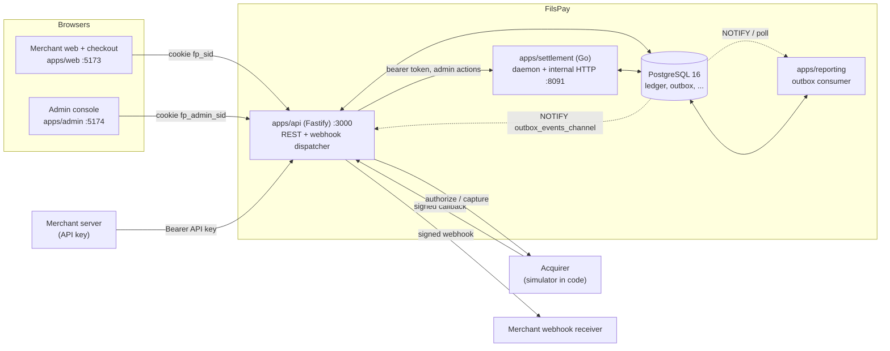
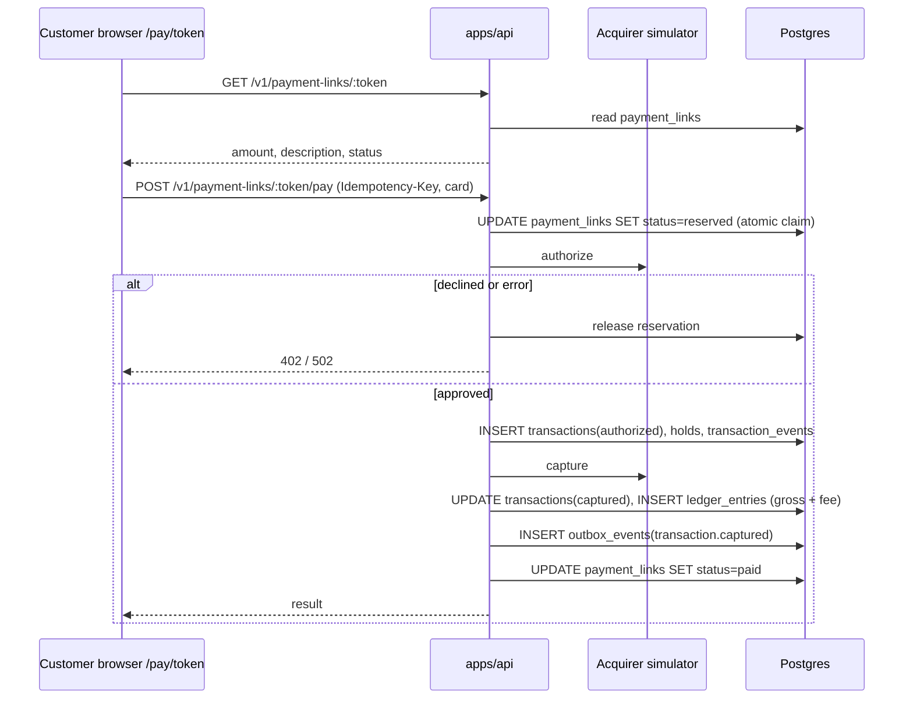
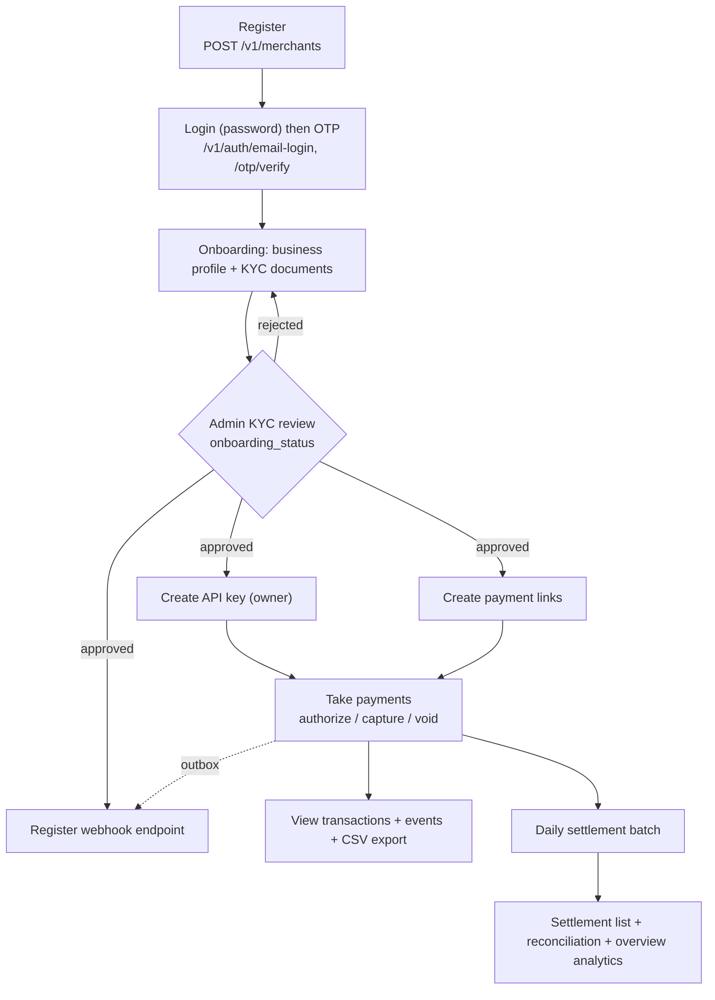
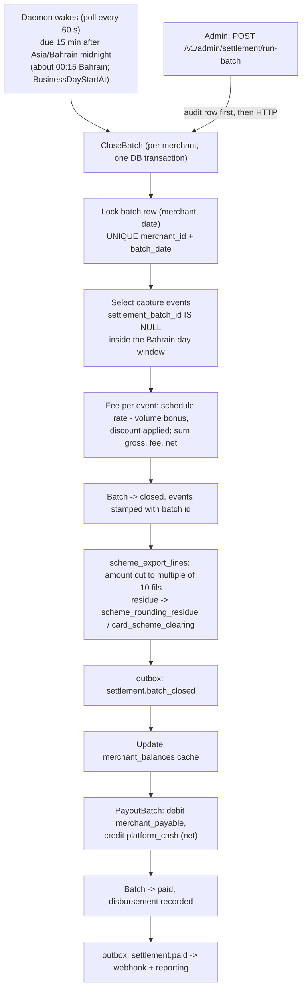
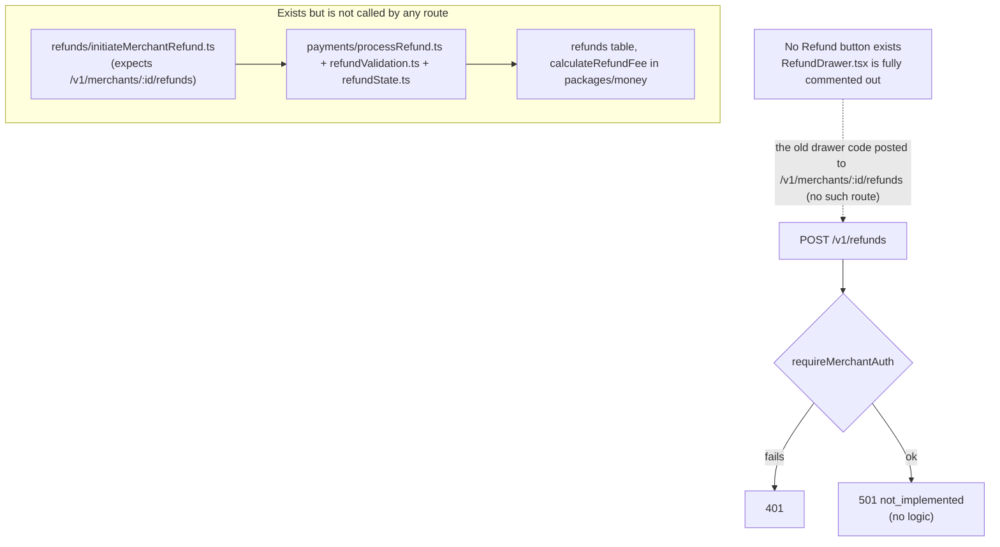
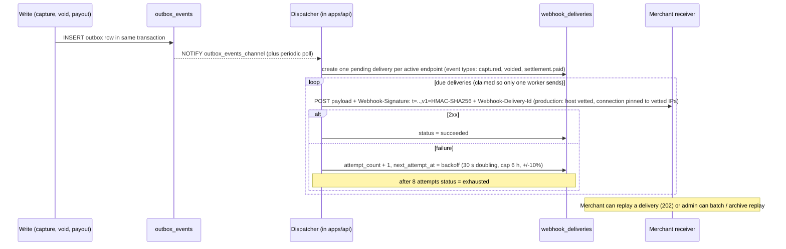
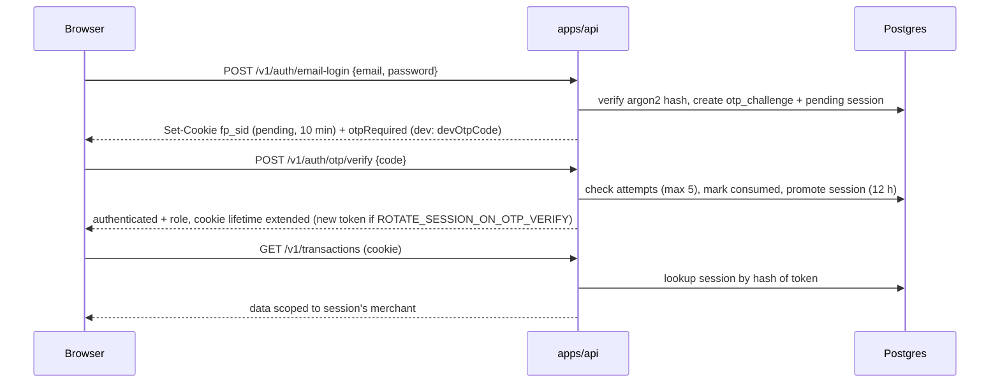
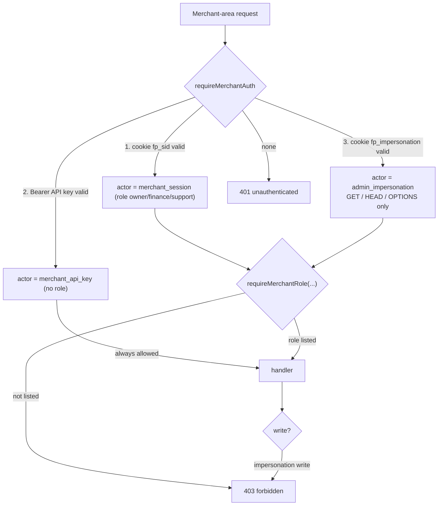
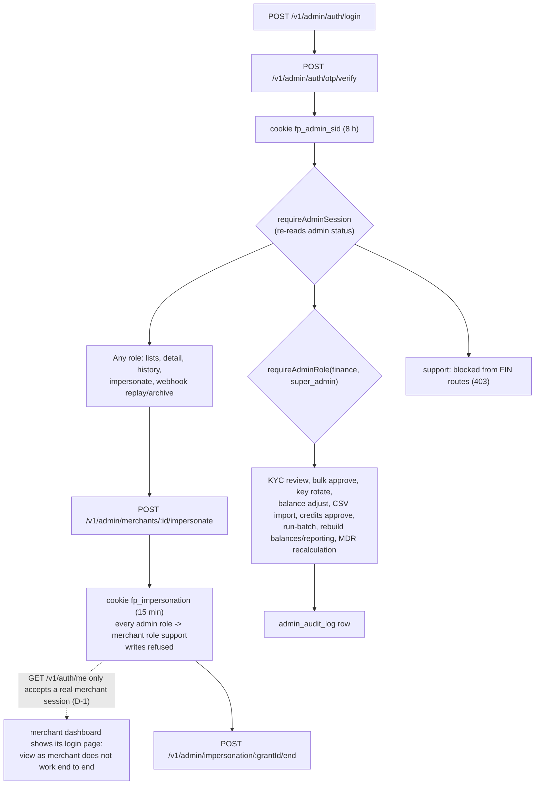
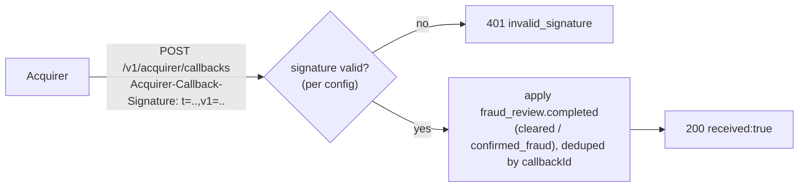

# FilsPay architecture diagrams

Mermaid diagrams drawn from the current source (refreshed 2026-10-30, after the
audit fixes). Money is integer fils (1 BD = 1000 fils). Settlement days follow
Asia/Bahrain time. Hand-checked, not rendered. Nothing here was exercised in a
live browser.

---

## 1. System architecture

The services share one database. The API never computes settlement; it asks the
Go service over HTTP. Inside the API, one app-level hook applies in-memory rate
limits (login, OTP, admin login, public pay, signup) before the route handlers
run; behind a load balancer set `TRUST_PROXY` so client IPs are correct.

---

## 2. Customer payment flow (payment link)

Direct API-key flow is the same without the link: `POST /v1/transactions`
(authorize, 201) then `POST /v1/transactions/:id/capture`, or `.../void`.

---

## 3. Merchant workflow

Only merchants with `onboarding_status = approved` and `status = active` can
authorize payments.

---

## 4. Settlement workflow

Re-running a closed or paid day is a no-op. Zero-activity days still produce a
closed batch with zeros. `RunDailyBatch` handles each merchant on its own: a
failing merchant is logged and skipped, the others are still closed and paid, and
a `BatchFailuresError` listing the failed merchants is returned at the end (the
CLI exits non-zero; the internal API answers HTTP 500 `run_batch_partial_failure`).
The daemon logs a partial failure and still calls `EnqueuePayoutNotifications` on
that tick, so `settlement.paid` events for the merchants that were paid are not held
back by one failing merchant (fixed during the audit; covered by the Go build and
suite, not exercised end to end).

Worked numbers: capture 10000 fils at 250 bps -> fee 250, net 9750.

---

## 5. Refund workflow (current state)

Nothing writes to `refunds` today. No `refund.*` webhook event exists. Project
rules say keep the 501 stub until the refund work is decided (FP-212). The
`RefundDrawer.tsx` is entirely commented out (`export {}`), so the dashed
arrow is only history. The helper `processRefund.ts` was fixed (blank reason becomes
`unspecified`, ownership check inside the helper) but still has no caller.

---

## 6. Webhook delivery

Test sends (`POST .../webhook-endpoints/:id/test`) skip the queue and are sent
synchronously. A replay creates a new delivery row with a new delivery id. The
delivery status `failed` is never set (only `pending`, `succeeded`, `exhausted`).
Deleted (soft-deleted) endpoints return 404 on test-send and detail.

---

## 7. Authentication and authorization

### 7.1 Merchant session + OTP

A pending session authenticates nothing. Resend is limited to once per 30 s and
carries over failed attempts; exhausting the attempts revokes the session. The
OTP code is drawn with `crypto.randomInt`. With `ROTATE_SESSION_ON_OTP_VERIFY`
on (default in production only), verify replaces the pending token with a new
one so a cookie copied during the OTP step is useless afterwards (session
fixation fix; the same for admin sessions).

### 7.2 Which credential reaches which route

Authorize (`POST /v1/transactions`) is **API key only**. Auth, KYC, profile and
API-key routes use the older `requireSession` (session only). Capture and void
now use `requireMerchantRole("owner", "finance")`, so a `support` session gets
403 while an API key still passes. The merchant dashboard's `GET /v1/auth/me`
uses `requireSession`, which is why the impersonation cookie does not get the
dashboard past its login gate (finding D-1).

### 7.3 Admin roles and impersonation

`requireAdminSession` never reads the merchant or impersonation cookies, so an
impersonation grant gives no admin power.

### 7.4 Acquirer callback

